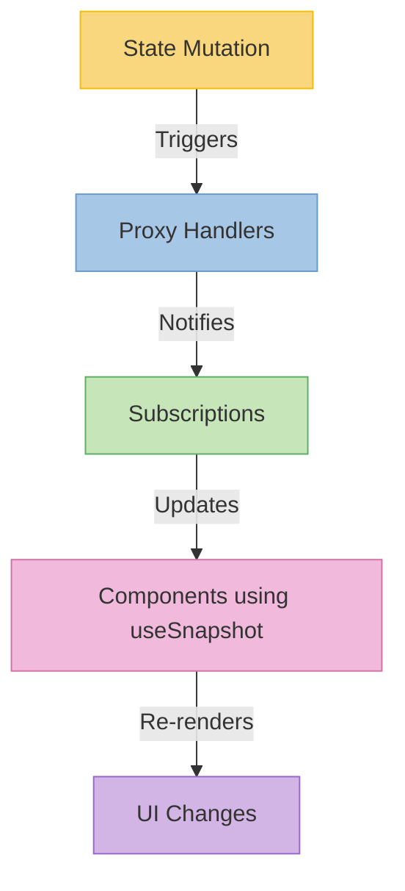

# State Management Guide

This guide provides a quick introduction to manage the statements of our project.

## What is Valtio?

[Valtio](https://valtio.dev/) is a lightweight state management library for React that turns any object into a reactive state with a proxy-based approach.

## Quick Start Guide

### 1. Defining State

```typescript
import { proxy } from 'valtio'

// Create a state object
const searchState = proxy<{ query: stirng; results: string[]; isLoading: boolean }>({
  query: '',
  results: [],
  isLoading: false
})
```

### 2. Updating State

Direct mutations:
```typescript
// You can directly mutate the state
searchState.query = 'new search term'
```

Semantic actions (recommended):
```typescript
// Better: Define semantic actions
function setSearchQuery(query: string) {
  searchState.query = query
  searchState.isLoading = true
}

function setSearchResults(results: any[]) {
  searchState.results = results
  searchState.isLoading = false
}
```

### 3. Using State in Components

```typescript
import { useSnapshot } from 'valtio'

function SearchComponent() {
  // Get a reactive snapshot of the state
  const snap = useSnapshot(searchState)
  
  return (
    <div>
      <input 
        value={snap.query} 
        onChange={(e) => setSearchQuery(e.target.value)} 
      />
      {snap.isLoading ? 'Loading...' : `${snap.results.length} results found`}
    </div>
  )
}
```

## How Valtio Updates Drive UI Changes



## Key Benefits

- 🚀 **Simple API**: Just mutate the state directly
- 🔄 **Reactive**: Components only re-render when used values change
- 🧩 **Composable**: Easy to split and combine state

Remember: When in doubt, use semantic action functions to keep your state updates clear and maintainable!